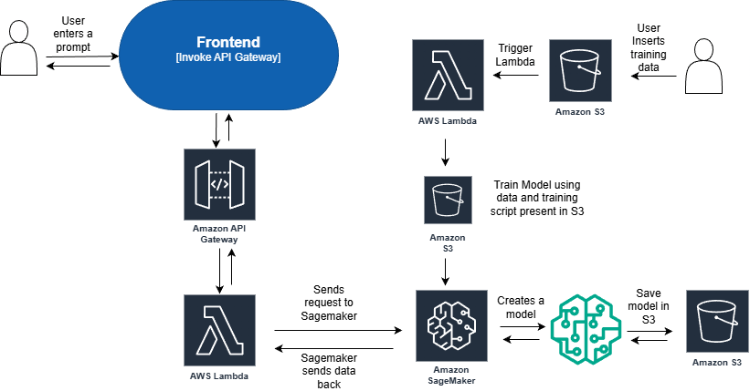
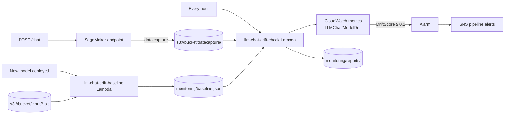

# Continuous Training (CI/CD/CT) on Amazon SageMaker

An event-driven MLOps pipeline that **retrains, redeploys and serves a model automatically whenever new training data arrives**. Upload a file to S3 and the pipeline fine-tunes a Hugging Face model on SageMaker managed spot instances, rolls the new model out to a live endpoint, and serves it through a REST chat API. All infrastructure is defined in Terraform.



## How it works

1. **New data arrives**: a `.txt` file is uploaded to `s3://<bucket>/input/`.
2. **Continuous training**: an S3 event invokes the `llm-trainer` Lambda, which starts a SageMaker training job that fine-tunes **T5-small** on all data under `input/`.
   - Runs on **managed spot instances** (typically far cheaper than on-demand), with per-epoch checkpoints synced to S3 so an interrupted job resumes instead of starting over.
   - Training loss is published to **CloudWatch** as the `train:loss` metric.
   - After training, the job scores the new model on a **held-out slice of the data** it never trained on, and scores the model that is currently serving on the same slice. See [Evaluation and the deploy gate](#evaluation-and-the-deploy-gate).
3. **Continuous deployment, only if better**: when the job completes, an **EventBridge** rule invokes the `llm-deployer` Lambda. It deploys the new model only if it scores at least as well as the serving model; otherwise it keeps the current model, tags the job `rejected` and sends an alert. A deployed model creates or updates the SageMaker endpoint, and SageMaker's blue/green update keeps the previous model serving until the new one is healthy.
4. **Serving**: `POST /chat` on API Gateway → `chat` Lambda → SageMaker endpoint.
5. **Alerting**: failed training jobs publish to an SNS topic (`<project>-pipeline-alerts`); subscribe your email to it.
6. **Continuous monitoring (drift detection)**: the endpoint captures every request and response to S3. After each deployment a Lambda rebuilds a **baseline** from the training data, and every hour another Lambda compares live traffic with it, publishes **drift scores to CloudWatch**, and writes a report to S3. A CloudWatch alarm emails the same SNS topic when drift is significant. See [Drift monitoring](#drift-monitoring).

## What this demonstrates

- Continuous training and continuous deployment driven by events (S3 → Lambda → SageMaker → EventBridge)
- A champion/challenger deploy gate: held-out evaluation (exact match, token F1) of the new model against the serving model, so a worse model is never deployed
- Cost optimization with managed spot training, checkpoint/resume, and S3 lifecycle expiry of checkpoints
- Fine-tuning a Hugging Face transformer and serving it with the Hugging Face inference container
- Observability with CloudWatch logs and training metrics, plus failure alerts via EventBridge and SNS
- Model drift monitoring on live traffic: endpoint data capture, a training-data baseline, PSI drift scores as custom CloudWatch metrics, and alarms
- Least-privilege IAM (bucket-scoped S3 access, scoped `iam:PassRole`), encrypted private S3 bucket
- Infrastructure as code with Terraform

## Training data format

One example per line, `input = target`:

```text
translate English to French: Hello = Bonjour
What is the capital of France? = Paris
```

## Design decisions

| Decision | Why |
|---|---|
| **Event-driven (S3 → Lambda → SageMaker → EventBridge)** instead of SageMaker Pipelines | Fewer moving parts for a single-model flow, and every step is visible as an ordinary AWS event. The deploy gate is one function in the deploy Lambda; SageMaker Pipelines becomes worthwhile once you need human approval or multi-step evaluation. |
| **Evaluate inside the training job, gate in the deploy Lambda** | The job already has the GPU/CPU, the data and the new model loaded, so scoring there needs no extra infrastructure. Scores travel as SageMaker training metrics, which the deploy Lambda reads from `describe-training-job`. |
| **Compare against the serving model on the same held-out data** | An absolute score threshold says little when the data keeps changing; scoring both models on the same examples answers the real question, "is the new one better than what users get now?" |
| **Hash-based train/eval split** | Each example's split depends only on its text, so adding data never moves old examples into training, and duplicates of a held-out example are held out too. |
| **Managed spot training with checkpoints** | Spot capacity is usually much cheaper than on-demand. Per-epoch checkpoints in S3 mean an interruption costs one epoch, not the whole job. |
| **Endpoint update instead of delete-and-recreate** | SageMaker shifts traffic only after the new model is healthy, so a bad model never takes the API down. |
| **S3 lifecycle expiry on checkpoints** | Checkpoints are only needed while a job runs; expiring them stops storage costs creeping up. |
| **Drift monitoring with Lambda + CloudWatch** instead of SageMaker Model Monitor | AWS has closed Model Monitor (and Clarify) to new customers and recommends custom monitoring. Two small Lambdas and custom metrics fit the event-driven design, cost pennies, and work for free-text (text2text) traffic where Model Monitor's tabular statistics would need a preprocessor anyway. |
| **Baseline from training data, rebuilt on every deployment** | "Normal" changes whenever a model trained on new data goes live, so the deploy Lambda rebuilds the baseline after it deploys. A rejected model leaves the baseline alone, because the old model is still serving. |

## Cost

| Component | Billing | Notes |
|---|---|---|
| Training job | Per second while running, spot discount applied | `aws sagemaker describe-training-job` shows `BillableTimeInSeconds` vs `TrainingTimeInSeconds`; the gap is your spot saving. |
| **Real-time endpoint** | **Per hour, 24/7, even with no traffic** | By far the largest cost for a demo. Delete it when idle (see Clean up), or switch to SageMaker Serverless Inference for spiky, low traffic. |
| Lambda, API Gateway, EventBridge, SNS | Per request | Pennies at demo scale. |
| Drift monitoring | Lambda run time + custom CloudWatch metrics and alarms | About a dozen custom metrics and two alarms; the hourly Lambda runs for seconds at demo traffic. |
| S3 | Per GB stored | Checkpoints expire after 7 days, captured traffic after 30 (`data_capture_retention_days`), drift reports after 90. |

Check current [SageMaker pricing](https://aws.amazon.com/sagemaker/pricing/) for your instance types and region.

## Deploy

Prerequisites: an AWS account, the AWS CLI configured for `us-east-1`, and Terraform.

```bash
cd SagemakerCICDCTLambda/terraform
terraform init
terraform apply -var bucket_name=<a-globally-unique-bucket-name>

# Package and upload the training code (train.py + requirements.txt)
../scripts/package_training_code.sh <bucket-name>

# Optional: get an email when a training job fails
aws sns subscribe --topic-arn <pipeline-alerts-topic-arn> --protocol email --notification-endpoint you@example.com
```

## Try it

```bash
# Upload training data: this starts a training job, then an automatic deployment
aws s3 cp data.txt s3://<bucket-name>/input/data.txt

# Follow progress
aws sagemaker list-training-jobs --name-contains llm-train --sort-by CreationTime
aws sagemaker describe-endpoint --endpoint-name llm-endpoint --query EndpointStatus

# Chat with the latest model once the endpoint is InService
curl -X POST "$(terraform output -raw api_url)" \
  -H "Content-Type: application/json" \
  -d '{"prompt": "What is the capital of France?"}'
```

## Evaluation and the deploy gate

Training loss only says the model fits its own training data. Before a new model replaces the live one, the pipeline checks it on data it has not seen.

1. **Held-out split.** `train.py` holds out about `EVAL_PERCENT` (default 10%) of distinct inputs, chosen by a hash of the input text, and trains on the rest. Tiny datasets still get at least one held-out example; with a single distinct input it trains and evaluates on the same data and reports `eval_on_train=1`.
2. **Champion vs challenger.** The trigger Lambda looks up the model behind the live endpoint and passes its `model.tar.gz` to the training job. After training, the job generates answers with both models on the held-out inputs (up to `MAX_EVAL`, default 200) and scores each with **exact match** and **token F1** (the SQuAD metrics: word overlap with the expected answer, after lowercasing and removing punctuation and articles).
3. **Metrics.** Scores are printed as `EVAL ...` lines, which SageMaker turns into training metrics (`eval:candidate_token_f1`, `eval:champion_token_f1`, and so on), and written to `evaluation.json` inside the model artifact with sample predictions.
4. **Gate.** The deploy Lambda deploys only when:
   - the job recorded `eval:candidate_token_f1` (unless `deploy_without_metrics = true`),
   - it is at least `min_token_f1` (default 0), and
   - it is no more than `deploy_tolerance` (default 0) below the serving model's score. The first model, with nothing serving yet, only needs to pass the first two checks.

   A rejected model is tagged `deployment-decision=rejected` with the reason, and the pipeline alerts topic gets an email with both scores.

```bash
# Why was (or wasn't) a model deployed?
aws sagemaker describe-training-job --training-job-name <job> --query FinalMetricDataList
aws sagemaker list-tags --resource-arn <training-job-arn>      # deployment-decision, deployment-reason

# Sample predictions from both models
aws s3 cp s3://<bucket-name>/llm-model/output/<job>/output/model.tar.gz - | tar -xzO evaluation.json | head -40
```

**Tuning** (Terraform variables): `min_token_f1`, `deploy_tolerance`, `deploy_without_metrics`.

**Limits.** The held-out examples come from the same files as the training data, so this checks generalization to similar data, not to what real users will ask. A small fixed set of real questions with expected answers, kept out of `input/`, is the next step. Token F1 also rewards word overlap, not correctness, for free-form answers.

## Drift monitoring



**What is measured.** Each request/response is turned into simple text features: prompt length (words, characters), share of digits and non-ASCII characters, whether it is a question or a T5-style task prompt (`translate ...:`), answer length, answer-to-prompt length ratio, and empty answers. The baseline describes the same features over the training data, with the training targets standing in for expected answers.

**How drift is scored.** For each feature, live traffic from the last `drift_window_hours` (default 24) is binned like the baseline and compared with the **Population Stability Index (PSI)**: below 0.1 means no meaningful change, 0.1–0.2 moderate, 0.2 or more significant. Values outside the range seen in training get their own bins, so they always register.

PSI alone is noisy on small samples, so a feature only counts as drifted when the shift is also **statistically significant**: a chi-square test on the binned counts, at a 1% false-alarm rate shared across all features (Bonferroni). `DriftScore` is the highest PSI among significant features, and 0 when none are. In simulations of unchanged traffic this kept false alarms around 1% or less from 30 samples upward, while still catching clear shifts (much longer prompts, a collapsed answer distribution) every time. Scoring needs at least `drift_min_samples` (default 30) captured requests.

**What you get**
- CloudWatch namespace `LLMChat/ModelDrift`: `DriftScore` and `SampleCount` per endpoint, plus `PSI` per feature
- Alarm `llm-chat-model-drift` (DriftScore ≥ `drift_psi_threshold`, default 0.2) and `llm-chat-drift-check-errors`, both to the pipeline alerts topic
- An hourly JSON report showing, per feature, the PSI, p-value, whether it is significant, and the baseline vs live mean:

```bash
aws s3 ls s3://<bucket-name>/monitoring/reports/ --recursive | tail -3
aws s3 cp s3://<bucket-name>/monitoring/reports/<YYYY/MM/DD/HH>.json - | head -40

# Run a check now instead of waiting for the schedule
aws lambda invoke --function-name llm-chat-drift-check /dev/stdout
```

**Responding to drift.** A drift alarm means live prompts or answers no longer look like the training data, for example much longer prompts, a new language, or many empty answers. Inspect the report and captured requests, add representative examples to `input/`, and the pipeline retrains, evaluates, and (if the new model is at least as good) redeploys and rebuilds the baseline automatically.

**Tuning** (Terraform variables): `data_capture_percent`, `data_capture_retention_days`, `drift_check_schedule`, `drift_window_hours`, `drift_min_samples`, `drift_psi_threshold`.

**Tests.** The monitoring code and the deploy gate are plain Python, unit-tested against in-memory AWS fakes. With PyTorch installed, a further test trains a tiny randomly initialised T5 on CPU, evaluates it against a second model acting as the champion, and checks that the trigger Lambda's metric regexes read exactly what `train.py` printed. CI runs both.

```bash
pip install pytest boto3
pytest SagemakerCICDCTLambda/tests        # training tests skip without torch

pip install torch transformers sentencepiece
pytest SagemakerCICDCTLambda/tests/test_training_gate.py
```

## Clean up

The endpoint, models and endpoint configs are created by the deploy Lambda, so delete them before `terraform destroy`:

```bash
aws sagemaker delete-endpoint --endpoint-name llm-endpoint
aws s3 rm s3://<bucket-name> --recursive   # the bucket must be empty to be deleted
terraform destroy -var bucket_name=<bucket-name>
```

SageMaker endpoints are billed while running, so delete the endpoint when you're not using it.
