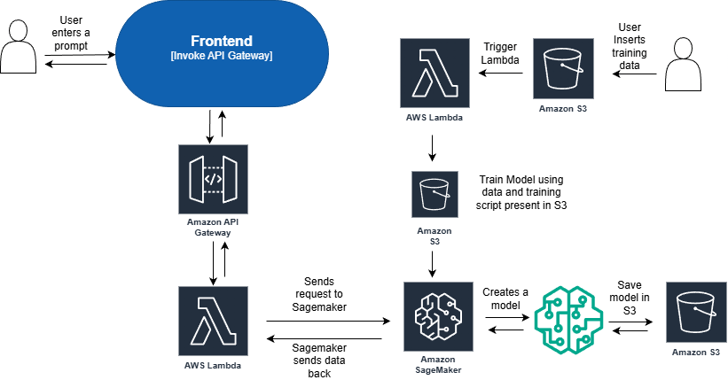

# Continuous Training (CI/CD/CT) on Amazon SageMaker

An event-driven MLOps pipeline that **retrains, redeploys and serves a model automatically whenever new training data arrives**. Upload a file to S3 and the pipeline fine-tunes a Hugging Face model on SageMaker managed spot instances, rolls the new model out to a live endpoint, and serves it through a REST chat API. All infrastructure is defined in Terraform.



## How it works

1. **New data arrives**: a `.txt` file is uploaded to `s3://<bucket>/input/`.
2. **Continuous training**: an S3 event invokes the `llm-trainer` Lambda, which starts a SageMaker training job that fine-tunes **T5-small** on all data under `input/`.
   - Runs on **managed spot instances** (typically far cheaper than on-demand), with per-epoch checkpoints synced to S3 so an interrupted job resumes instead of starting over.
   - Training loss is published to **CloudWatch** as the `train:loss` metric.
3. **Continuous deployment**: when the job completes, an **EventBridge** rule invokes the `llm-deployer` Lambda, which registers the new model and creates or updates the SageMaker endpoint. SageMaker's blue/green update keeps the previous model serving until the new one is healthy.
4. **Serving**: `POST /chat` on API Gateway → `chat` Lambda → SageMaker endpoint.
5. **Alerting**: failed training jobs publish to an SNS topic (`<project>-pipeline-alerts`); subscribe your email to it.

## What this demonstrates

- Continuous training and continuous deployment driven by events (S3 → Lambda → SageMaker → EventBridge)
- Cost optimization with managed spot training, checkpoint/resume, and S3 lifecycle expiry of checkpoints
- Fine-tuning a Hugging Face transformer and serving it with the Hugging Face inference container
- Observability with CloudWatch logs and training metrics, plus failure alerts via EventBridge and SNS
- Least-privilege IAM (bucket-scoped S3 access, scoped `iam:PassRole`), encrypted private S3 bucket
- Infrastructure as code with Terraform

## Training data format

One example per line, `input = target`:

```text
translate English to French: Hello = Bonjour
What is the capital of France? = Paris
```

## Deploy

Prerequisites: an AWS account, the AWS CLI configured for `us-east-1`, and Terraform.

```bash
cd SagemakerCICDCTLambda/terraform
terraform init
terraform apply -var bucket_name=<a-globally-unique-bucket-name>

# Package and upload the training code (train.py + requirements.txt)
../scripts/package_training_code.sh <bucket-name>

# Optional: get an email when a training job fails
aws sns subscribe --topic-arn <pipeline-alerts-topic-arn> --protocol email --notification-endpoint you@example.com
```

## Try it

```bash
# Upload training data: this starts a training job, then an automatic deployment
aws s3 cp data.txt s3://<bucket-name>/input/data.txt

# Follow progress
aws sagemaker list-training-jobs --name-contains llm-train --sort-by CreationTime
aws sagemaker describe-endpoint --endpoint-name llm-endpoint --query EndpointStatus

# Chat with the latest model once the endpoint is InService
curl -X POST "$(terraform output -raw api_url)" \
  -H "Content-Type: application/json" \
  -d '{"prompt": "What is the capital of France?"}'
```

## Clean up

The endpoint, models and endpoint configs are created by the deploy Lambda, so delete them before `terraform destroy`:

```bash
aws sagemaker delete-endpoint --endpoint-name llm-endpoint
aws s3 rm s3://<bucket-name> --recursive   # the bucket must be empty to be deleted
terraform destroy -var bucket_name=<bucket-name>
```

SageMaker endpoints are billed while running, so delete the endpoint when you're not using it.
