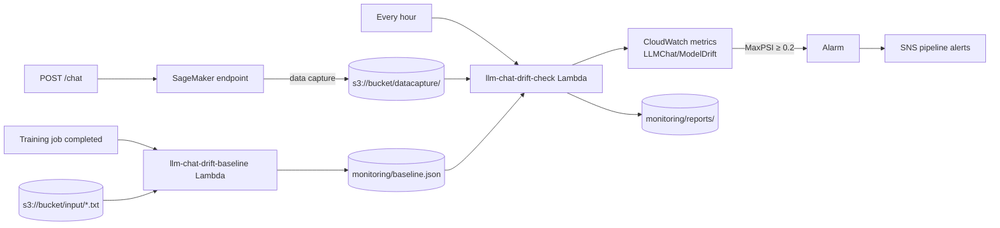

# Continuous Training (CI/CD/CT) on Amazon SageMaker

An event-driven MLOps pipeline that **retrains, redeploys and serves a model automatically whenever new training data arrives**. Upload a file to S3 and the pipeline fine-tunes a Hugging Face model on SageMaker managed spot instances, rolls the new model out to a live endpoint, and serves it through a REST chat API. All infrastructure is defined in Terraform.


## How it works

1. **New data arrives**: a `.txt` file is uploaded to `s3://<bucket>/input/`.
2. **Continuous training**: an S3 event invokes the `llm-trainer` Lambda, which starts a SageMaker training job that fine-tunes **T5-small** on all data under `input/`.
   - Runs on **managed spot instances** (typically far cheaper than on-demand), with per-epoch checkpoints synced to S3 so an interrupted job resumes instead of starting over.
   - Training loss is published to **CloudWatch** as the `train:loss` metric.
3. **Continuous deployment**: when the job completes, an **EventBridge** rule invokes the `llm-deployer` Lambda, which registers the new model and creates or updates the SageMaker endpoint. SageMaker's blue/green update keeps the previous model serving until the new one is healthy.
4. **Serving**: `POST /chat` on API Gateway → `chat` Lambda → SageMaker endpoint.
5. **Alerting**: failed training jobs publish to an SNS topic (`<project>-pipeline-alerts`); subscribe your email to it.
6. **Continuous monitoring (drift detection)**: the endpoint captures every request and response to S3. After each training run a Lambda rebuilds a **baseline** from the training data, and every hour another Lambda compares live traffic with it, publishes **drift scores to CloudWatch**, and writes a report to S3. A CloudWatch alarm emails the same SNS topic when drift is significant. See [Drift monitoring](#drift-monitoring).

## What this demonstrates

- Continuous training and continuous deployment driven by events (S3 → Lambda → SageMaker → EventBridge)
- Cost optimization with managed spot training, checkpoint/resume, and S3 lifecycle expiry of checkpoints
- Fine-tuning a Hugging Face transformer and serving it with the Hugging Face inference container
- Observability with CloudWatch logs and training metrics, plus failure alerts via EventBridge and SNS
- Model drift monitoring on live traffic: endpoint data capture, a training-data baseline, PSI drift scores as custom CloudWatch metrics, and alarms
- Least-privilege IAM (bucket-scoped S3 access, scoped `iam:PassRole`), encrypted private S3 bucket
- Infrastructure as code with Terraform

## Training data format

One example per line, `input = target`:

```text
translate English to French: Hello = Bonjour
What is the capital of France? = Paris
```

## Design decisions

| Decision | Why |
|---|---|
| **Event-driven (S3 → Lambda → SageMaker → EventBridge)** instead of SageMaker Pipelines | Fewer moving parts for a single-model flow, and every step is visible as an ordinary AWS event. SageMaker Pipelines becomes worthwhile once you need approval gates or multi-step evaluation. |
| **Managed spot training with checkpoints** | Spot capacity is usually much cheaper than on-demand. Per-epoch checkpoints in S3 mean an interruption costs one epoch, not the whole job. |
| **Endpoint update instead of delete-and-recreate** | SageMaker shifts traffic only after the new model is healthy, so a bad model never takes the API down. |
| **S3 lifecycle expiry on checkpoints** | Checkpoints are only needed while a job runs; expiring them stops storage costs creeping up. |
| **Drift monitoring with Lambda + CloudWatch** instead of SageMaker Model Monitor | AWS has closed Model Monitor (and Clarify) to new customers and recommends custom monitoring. Two small Lambdas and custom metrics fit the event-driven design, cost pennies, and work for free-text (text2text) traffic where Model Monitor's tabular statistics would need a preprocessor anyway. |
| **Baseline from training data, rebuilt on every training run** | "Normal" changes whenever the model is retrained on new data, so the baseline is refreshed by the same event that deploys the new model. |

## Cost

| Component | Billing | Notes |
|---|---|---|
| Training job | Per second while running, spot discount applied | `aws sagemaker describe-training-job` shows `BillableTimeInSeconds` vs `TrainingTimeInSeconds`; the gap is your spot saving. |
| **Real-time endpoint** | **Per hour, 24/7, even with no traffic** | By far the largest cost for a demo. Delete it when idle (see Clean up), or switch to SageMaker Serverless Inference for spiky, low traffic. |
| Lambda, API Gateway, EventBridge, SNS | Per request | Pennies at demo scale. |
| Drift monitoring | Lambda run time + custom CloudWatch metrics and alarms | About a dozen custom metrics and two alarms; the hourly Lambda runs for seconds at demo traffic. |
| S3 | Per GB stored | Checkpoints expire after 7 days, captured traffic after 30 (`data_capture_retention_days`), drift reports after 90. |

Check current [SageMaker pricing](https://aws.amazon.com/sagemaker/pricing/) for your instance types and region.

## Deploy

Prerequisites: an AWS account, the AWS CLI configured for `us-east-1`, and Terraform.

```bash
cd SagemakerCICDCTLambda/terraform
terraform init
terraform apply -var bucket_name=<a-globally-unique-bucket-name>

# Package and upload the training code (train.py + requirements.txt)
../scripts/package_training_code.sh <bucket-name>

# Optional: get an email when a training job fails
aws sns subscribe --topic-arn <pipeline-alerts-topic-arn> --protocol email --notification-endpoint you@example.com
```

## Try it

```bash
# Upload training data: this starts a training job, then an automatic deployment
aws s3 cp data.txt s3://<bucket-name>/input/data.txt

# Follow progress
aws sagemaker list-training-jobs --name-contains llm-train --sort-by CreationTime
aws sagemaker describe-endpoint --endpoint-name llm-endpoint --query EndpointStatus

# Chat with the latest model once the endpoint is InService
curl -X POST "$(terraform output -raw api_url)" \
  -H "Content-Type: application/json" \
  -d '{"prompt": "What is the capital of France?"}'
```

## Drift monitoring



**What is measured.** Each request/response is turned into simple text features: prompt length (words, characters), share of digits and non-ASCII characters, whether it is a question or a T5-style task prompt (`translate ...:`), answer length, answer-to-prompt length ratio, and empty answers. The baseline describes the same features over the training data, with the training targets standing in for expected answers.

**How drift is scored.** For each feature, live traffic from the last `drift_window_hours` (default 24) is binned like the baseline and compared with the **Population Stability Index (PSI)**: below 0.1 means no meaningful change, 0.1–0.2 moderate, 0.2 or more significant. Scoring needs at least `drift_min_samples` (default 30) captured requests, so a quiet endpoint never raises a false alarm.

**What you get**
- CloudWatch namespace `LLMChat/ModelDrift`: `MaxPSI` and `SampleCount` per endpoint, plus `PSI` per feature
- Alarm `llm-chat-model-drift` (MaxPSI ≥ `drift_psi_threshold`, default 0.2) and `llm-chat-drift-check-errors`, both to the pipeline alerts topic
- An hourly JSON report showing which feature moved and its baseline vs live mean:

```bash
aws s3 ls s3://<bucket-name>/monitoring/reports/ --recursive | tail -3
aws s3 cp s3://<bucket-name>/monitoring/reports/<YYYY/MM/DD/HH>.json - | head -40

# Run a check now instead of waiting for the schedule
aws lambda invoke --function-name llm-chat-drift-check /dev/stdout
```

**Responding to drift.** A drift alarm means live prompts or answers no longer look like the training data, for example much longer prompts, a new language, or many empty answers. Inspect the report and captured requests, add representative examples to `input/`, and the pipeline retrains, redeploys and rebuilds the baseline automatically.

**Tuning** (Terraform variables): `data_capture_percent`, `data_capture_retention_days`, `drift_check_schedule`, `drift_window_hours`, `drift_min_samples`, `drift_psi_threshold`.

**Tests.** The monitoring code is plain Python (no numpy), so it runs in Lambda and is unit-tested against in-memory S3/CloudWatch fakes:

```bash
pip install pytest boto3
pytest SagemakerCICDCTLambda/tests
```

## Clean up

The endpoint, models and endpoint configs are created by the deploy Lambda, so delete them before `terraform destroy`:

```bash
aws sagemaker delete-endpoint --endpoint-name llm-endpoint
aws s3 rm s3://<bucket-name> --recursive   # the bucket must be empty to be deleted
terraform destroy -var bucket_name=<bucket-name>
```

SageMaker endpoints are billed while running, so delete the endpoint when you're not using it.
